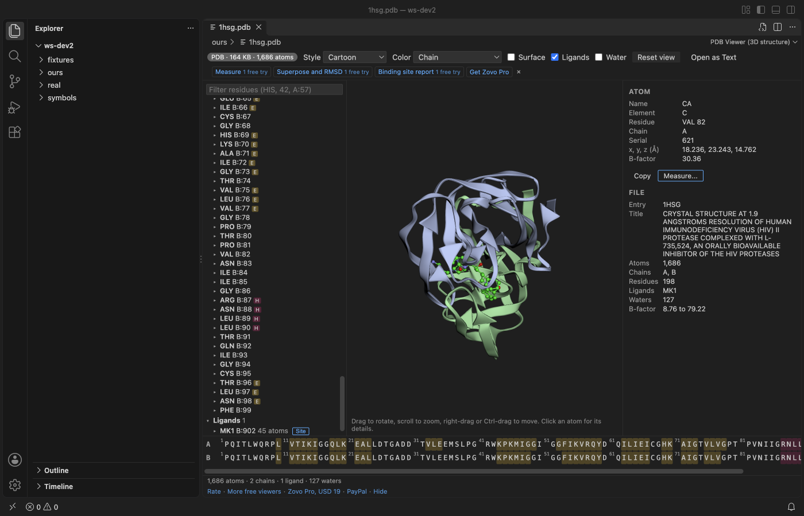

# PDB Viewer & Protein Structure

Open PDB, mmCIF, SDF, MOL2, XYZ, GRO and PQR files in VS Code as a 3D protein or molecule model, with a tree of chains, residues and ligands and the sequence below. Made by Zovo.

Free, with no account and no network calls:

- Opens .pdb, .ent, .cif, .mmcif, .pqr, .sdf, .mol, .mol2, .xyz and .gro files, and gzipped .pdb.gz, .ent.gz, .cif.gz and .mmcif.gz downloads, as a 3D model.
- Cartoon, ball and stick, sticks, spheres or lines, with an optional surface. Color by chain, residue type, element, B-factor or secondary structure.
- A side tree of chains, residues and ligands with a filter. Click a residue to zoom to it, open it to list its atoms.
- Click an atom to see its name, element, residue, chain, serial number, coordinates and B-factor.
- A sequence strip for each chain, linked to the 3D view both ways.
- NMR models and multi-frame XYZ, SDF or GRO files: pick the model or frame to show.
- Works the same in Remote SSH, WSL and container windows: VS Code reads the file where it is and hands it to the viewer, so you do not copy cluster files to your computer first. No PyMOL or other program is needed.

Zovo Pro: USD 19 once, for the Pro tools in every Zovo extension. Each Pro tool has 1 free try on your computer first:

- Measure: distances, angles and dihedrals by clicking atoms, hydrogen bond candidates and contacts within a distance you choose, drawn in the 3D view and saved as CSV.
- Superpose and RMSD: fit a second structure onto the open one on sequence-matched C-alpha atoms. You get the RMSD overall, per chain and per residue, both models overlaid in 3D, a CSV table and the moved structure as a PDB file.
- Binding site report: the residues within a distance of a ligand, with the closest atoms, contact counts and hydrogen bond candidates, a focused 3D view, a CSV table and a PNG image.

## How to use it

- Click a structure file in the Explorer. It opens in the viewer. To read the text instead, click Open as Text in the toolbar or the file icon at the top right.
- Drag to rotate, scroll to zoom, right-drag or Ctrl-drag to move. Reset view fits the whole structure again.
- Type in the filter above the tree: a residue name (`HIS`), a number (`25`) or chain and number (`B:25`).
- To try it without your own files, run PDB Viewer: Open the Sample Protein (1HSG) from the Command Palette. The samples are entries 1HSG and 1CRN from the Protein Data Bank.
- The Pro tools are in the Command Palette (PDB Viewer: ... (Pro)), in the Explorer right-click menu, in the small row at the end of the viewer toolbar, behind the Measure button under the atom details and the Site button on each ligand. The row closes with its x for the rest of the session, and the setting `pdbViewer.showProTools` hides the Pro tools for good.

## Debug symbol files named .pdb

Windows compilers write debug symbols to .pdb files too. The viewer checks the first bytes. When a .pdb file starts with `Microsoft C/C++ MSF 7.00`, `Microsoft C/C++ program database 2.00` or the .NET `BSJB` header, it shows a short note instead of an error, with buttons to open the file in a hex editor (when one is installed), with another editor or as text. It never switches the tab to another editor by itself.

## What it reads

| File | What it uses |
|---|---|
| PDB, ENT (.pdb, .ent, .pdb1) | ATOM and HETATM records, MODEL blocks, HELIX and SHEET, TITLE |
| mmCIF (.cif, .mmcif, .mcif) | The atom_site table with author chain and residue numbers, models, struct_conf and struct_sheet_range |
| Small-molecule CIF | Fractional coordinates turned into angstrom with the unit cell |
| PQR | Charges and radii as written by PDB2PQR-style tools |
| SDF, MOL | V2000 and V3000 records, every record as one model, bonds and charges |
| MOL2 | Atoms, bonds and substructure names |
| XYZ | One or more frames, element symbols or atomic numbers |
| GRO | GROMACS coordinates in nm, shown in angstrom, one or more frames |

## Privacy

The extension reads the file you open and nothing else. It makes no network calls, and nothing is uploaded or measured. The 3D view is drawn by 3Dmol.js, which is part of the extension. The Pro tools write only the files you ask for. The links at the bottom of the viewer (Rate, More free tools, Zovo Pro) open a page only when you click them, and the setting `pdbViewer.showSupportLinks` hides them.

## Settings

| Setting | Default | What it does |
|---|---|---|
| `pdbViewer.style` | auto | Style a file opens with: cartoon for proteins and nucleic acids, ball and stick for small molecules. |
| `pdbViewer.color` | auto | Coloring a file opens with: by chain for proteins, by element for small molecules. |
| `pdbViewer.background` | theme | Background of the 3D view: your theme's editor background, black or white. |
| `pdbViewer.bindingSiteRadius` | 5 | Distance in angstrom the binding site report starts with. |
| `pdbViewer.hbondCutoff` | 3.5 | Longest N or O pair distance Measure lists as a hydrogen bond candidate. |
| `pdbViewer.showProTools` | true | Shows the Pro tools in menus, the palette and the toolbar row. |
| `pdbViewer.showSupportLinks` | true | Shows the Rate, More free tools and Zovo Pro links. |
| `pdbViewer.askForRating` | true | Asks once for a rating after two good uses at least 30 minutes apart. |

## Zovo Pro

One payment of USD 19 unlocks the Pro tools in every Zovo extension on your computers; a team of 5 is USD 59. The key works offline. Run Zovo Pro: Get Zovo Pro from the Command Palette, or click Get Zovo Pro in the toolbar row. The Zovo Pro tab lists this extension's Pro tools and your free tries before any payment page opens.

Hydrogen bonds in Measure and in the binding site report are candidates found by distance between nitrogen and oxygen atoms. Hydrogen positions and angles are not checked.
